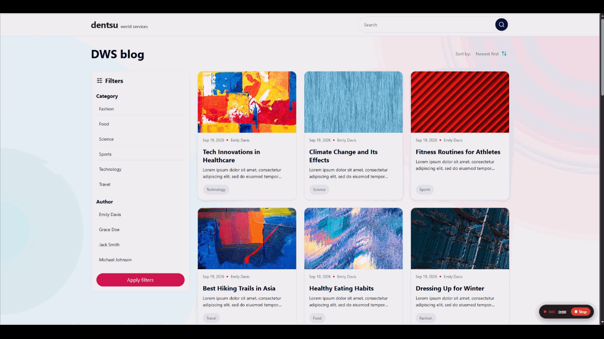

# DWS Blog

Front-end challenge for the **DWS – Dentsu World Services** Front End team.

A responsive, mobile-first blog built with **React + TypeScript**, with two views — the list of posts and the post detail page — plus search, category/author filters and sorting.

> **Live demo:** 

---

## Table of contents

- [Tech stack](#tech-stack)
- [Getting started](#getting-started)
- [Available scripts](#available-scripts)
- [Running the tests](#running-the-tests)
- [Project structure](#project-structure)
- [How I built it](#how-i-built-it)
- [Decisions and trade-offs](#decisions-and-trade-offs)
- [What I would do next](#what-i-would-do-next)

---

## Tech stack

| Area | Choice |
| --- | --- |
| UI | React 19 with hooks (no frameworks like Next.js or Gatsby, as requested) |
| Language | TypeScript (strict mode) |
| Build tool | Vite |
| Routing | React Router |
| Styling | SCSS Modules + design tokens (no UI or CSS libraries) |
| State management | Context API + `useReducer` |
| Icons | lucide-react |
| Tests | Vitest + React Testing Library + jest-dom + user-event |
| Coverage | `@vitest/coverage-v8` |

---

## Getting started

### Requirements

- **Node.js 20.19 or newer**
- **npm** (comes with Node.js)

### 1. Clone the repository

```bash
git clone <your-repository-url>
cd frontend-test
```

### 2. Install the dependencies

```bash
npm install
```

### 3. Start the app

```bash
npm start
```

Open **http://localhost:5173** in your browser.

### (Optional) Use another API

The app uses `https://tech-test-backend.dwsbrazil.io` by default. To point it somewhere else,
create a `.env` file in the project root:

```env
VITE_API_URL=https://tech-test-backend.dwsbrazil.io
```

---

## Available scripts

| Command | What it does |
| --- | --- |
| `npm start` | Starts the development server |
| `npm run dev` | Same as `npm start` |
| `npm run build` | Type-checks and builds the production bundle into `dist/` |
| `npm test` | Runs the tests in **watch mode** (re-runs on every save) |
| `npm run test:run` | Runs all tests **once** |
| `npm run coverage` | Runs all tests once and generates a **coverage report** |

---

## Running the tests

```bash
npm test
```

Runs Vitest in watch mode. Press `q` to quit. To run everything once:

```bash
npm run test:run
```

### Coverage

```bash
npm run coverage
```

A summary is printed in the terminal and a full HTML report is generated in `coverage/`
(open `coverage/index.html` in the browser).

### What is tested

Tests live next to the code they test (`Component.test.tsx`) and follow the
[Testing Library principles](https://testing-library.com/docs/guiding-principles/):
they query the page the way a user or a screen reader would — by role, label and text —
not by CSS classes or implementation details.

I didn't aim for 100% coverage. I prioritised what carries logic or risk:

| Area | What is covered |
| --- | --- |
| **API client** (`lib/api`) | success, HTTP errors, invalid JSON, network failures and aborted requests, with `fetch` mocked |
| **Hooks** | `usePosts` and `useCachedFetch` (cache and shared requests), `usePost` (router state, errors and a race condition), `useDebounce`, `useAuthors`, `useCategories` |
| **Pages** | the list page with the real filters, sorting and every async state; the detail page with its content, "Latest articles", Back button, loading, 404 and errors |
| **Filters** | `FilterItem`, `FilterGroup`, `FilterDropdown` (keyboard and click outside), `FilterPanel` (draft vs. applied), `MobileFilter`, `Sort` |
| **Search** | debounce, Enter, clearing, Escape, mobile open/close and navigation from a post page |
| **UI states** | `PostCard`, `CategoryTag`, `StatusMessage`, `ErrorState`, `NotFound`, `Loading` |

In the page tests, only the data hooks are mocked. Routing, components, the reducer and the
filtering logic are the real ones, so the tests break if any of those pieces stops working together.

---

## Project structure

```
src/
├── lib/                  # api() fetch wrapper + ApiError
├── services/             # one function per endpoint (posts, authors, categories)
├── types/                # Post, Author, Category
├── features/
│   └── filters/          # reducer, context, hooks and filterPosts()
├── hooks/                # usePosts, usePost, useCachedFetch, useAuthors,
│                         # useCategories, useDebounce, useClickOutside
├── components/
│   ├── Filters/          # FilterItem, FilterGroup, FilterPanel (desktop),
│   │                     # FilterDropdown + MobileFilter (mobile), Sort
│   ├── Header/           # logo + Search
│   ├── Search/
│   ├── PostCard/
│   ├── CategoryTag/
│   ├── Loading/
│   ├── StatusMessage/    # base for empty / error / not-found states
│   ├── ErrorState/
│   ├── NotFound/
│   └── ScrollToTop/
├── pages/
│   ├── PostList/
│   └── PostDetail/
├── styles/
│   ├── _variables.scss   # design tokens (colors, type scale, spacing, grid)
│   ├── _mixins.scss      # media queries, typography, container, a11y helpers
│   └── global.scss       # reset and base styles
├── utils/                # formatDate
└── test/setup.ts         # jest-dom matchers + cleanup
```

Each component keeps its `.tsx`, `.module.scss` and `.test.tsx` in the same folder.

---

## How I built it

### 1. Design tokens first

Before writing any component I turned the design into **SCSS tokens**: the color palette
(neutrals, primary, secondary, accent), the type scale (H1 to Caption, Open Sans), the spacing
scale, border radii, breakpoints and the grids from the layout
(**mobile: 4 columns, 16px margin and gutter / desktop: 12 columns, 56px margin, 24px gutter**).

Components use tokens like `$secondary-medium` and `$space-4` instead of raw values,
so a change in the design is a one-line change.

### 2. Mobile first

Every stylesheet starts with the mobile layout and adds desktop changes on top with an
`mq()` mixin (`min-width` media queries). Some parts of the UI change completely between
breakpoints, following the design:

| | Mobile | Desktop |
| --- | --- | --- |
| Search | round button that expands into a field | always-visible search field |
| Filters | `Category ▾` / `Author ▾` dropdowns, applied on click | sidebar with an **Apply filters** button |
| Posts | 1 column (2 on tablet) | 3 columns next to the sidebar |

### 3. Data layer

- **`api()`** wraps `fetch`: it adds the base URL, throws a typed `ApiError` for non-2xx responses
  and network failures, and supports cancellation with `AbortSignal`.
- **Services** expose one function per endpoint, so components and hooks never build URLs.
- **Custom hooks** handle loading, error and data state, so the pages only render.
- Responses are **cached in memory and in-flight requests are shared**: going back to the list,
  rendering "Latest articles", or showing the sidebar and the mobile filters at the same time
  never repeats a request.
- The detail page receives the post through **router state** when the user comes from the list,
  and only calls `GET /posts/{id}` on a direct link or a refresh. The URL id is always the source of truth.

### 4. Filters and state management

The API has no filter endpoints and returns every post with its author and categories,
so **search, filters and sorting run on the client**.

```
Search / FilterPanel / Dropdowns / Sort
        │  dispatch(action)
        ▼
FiltersProvider (useReducer)  →  { search, categoryIds, authorIds, sort }
        │  useFilters()
        ▼
PostListPage  →  filterPosts(posts, filters)  →  cards
```

- Components never talk to each other; they **dispatch actions** to one reducer and
  **read** from one shared state.
- `filterPosts` is a **pure function**: different filters combine with AND, options inside
  the same filter combine with OR, and an empty filter doesn't restrict anything.
- The search input is **debounced (300ms)**, so the list is filtered once per pause, not on every keystroke.
- State and dispatch live in **two separate contexts**, so components that only change filters
  don't re-render when the filters change.
- The desktop sidebar keeps a **local draft** and only updates the global filters on
  "Apply filters", as in the design. If the filters change elsewhere, the draft follows.

### 5. Every async state is handled

| State | What the user sees |
| --- | --- |
| Loading | a spinner |
| Error | a message with **Try again**, and a specific message when the user is offline |
| Empty | "No posts found", with **Clear filters** when filters are active |
| Not found | a 404 page for unknown routes and for posts that don't exist |

### 6. Accessibility

- Semantic HTML: `main`, `article`, `aside`, `section`, `ul/li`, `time`, one `h1` per page
- Filters are real `<button>`s with `aria-pressed`, so they work with the keyboard and screen readers
- Icon-only buttons have an `aria-label`; decorative icons are hidden from screen readers
- An `aria-live` region announces how many posts were found after each filter change
- Visible focus styles; `Esc` closes the dropdowns and the mobile search and returns the focus
- Animations respect `prefers-reduced-motion`

### 7. Bugs the tests found

Writing the tests caught real bugs, which I fixed:

- **Race condition on the detail page.** When switching posts quickly (for example, from
  "Latest articles"), a slow response for the previous post could arrive last and replace the
  current one. A test that resolves two requests in the wrong order reproduced it; the fix
  passes the `AbortSignal` to the request and ignores responses from cancelled requests.
- **Wrong date on the detail page.** It showed the date the author was created instead of the
  date the post was published.
- **Dates shifting by timezone.** The API returns UTC timestamps; formatting them in the user's
  timezone showed the previous day in Brazil (UTC−3) for posts created after midnight UTC.
  Dates are now formatted in UTC.

---

## Decisions and trade-offs

**Context + `useReducer` instead of Redux.**
The global state is small (four fields) and shared by a handful of components. The reducer
gives the same predictability as Redux — typed actions and pure, testable logic — without an
extra dependency. If the state grew or changed very often, I would move to Redux Toolkit or Zustand.

**Client-side filtering.**
The right choice for this API and data size: results are instant and no extra requests are made.
With thousands of posts, I would move search and filters to the back end with pagination.

**Custom fetching hooks instead of a data library.**
The challenge asks to show React skills, so I wrote the loading, error and cache logic with hooks.
In a production app I would use TanStack Query for caching, retries and background refetching.

**SCSS Modules.**
Class names are scoped to each component, and the tokens and mixins keep the styling consistent
with the design system.